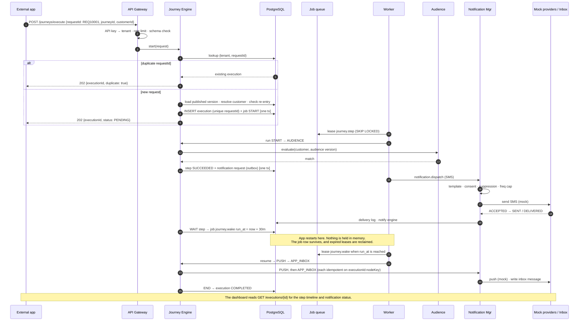
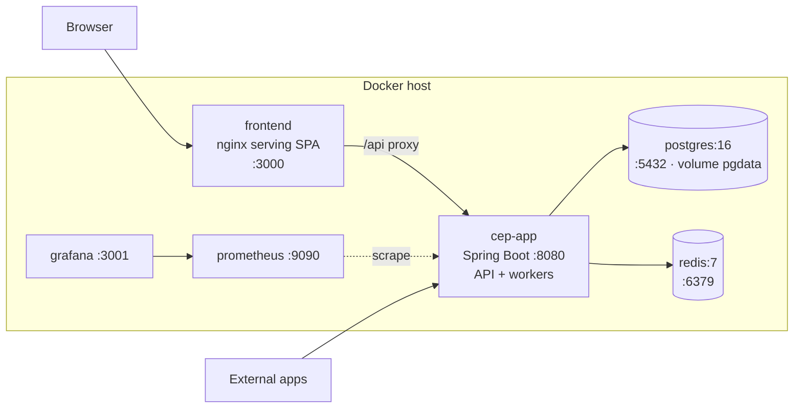

# End-to-End Architecture Diagram

This page has three views: the system components (§1), a single request traced through them (§2), and how it runs in Docker Compose (§3). Details are in [ARCHITECTURE.md](ARCHITECTURE.md). Rendered images are in [`diagrams/`](diagrams/).

## 1. System view

```mermaid
flowchart LR
  %% ---------- Actors ----------
  subgraph ACT["Clients"]
    direction TB
    EXT["External applications<br/>(order, CRM, mobile backends)"]
    BIZ["Business users<br/>(marketers, admins)"]
    DEV["Customer devices<br/>(mobile app / web)"]
  end

  %% ---------- Frontend ----------
  subgraph FE["Dashboard SPA (React · TS · MUI)"]
    direction TB
    JB["Journey Builder<br/>React Flow canvas"]
    PAGES["Audiences · Templates · Customer 360<br/>Executions · Notifications · Analytics · Config"]
  end

  %% ---------- Platform ----------
  subgraph CEP["Customer Engagement Platform: Spring Boot modular monolith (Java 21)"]
    direction LR

    subgraph GW["API Gateway layer"]
      direction TB
      AUTH["AuthN: API key / JWT<br/>RBAC · tenant resolution"]
      RL["Rate limit · idempotency<br/>schema validation · OpenAPI"]
    end

    subgraph SYNC["Domain modules"]
      direction TB
      AUD["Audience Mgmt<br/>versions · rule evaluator"]
      EVT["Event Ingestion<br/>schemas · dedup"]
      CUS["Customer Profile<br/>attributes · devices"]
      PREF["Preferences<br/>consent · quiet hours"]
      JM["Journey Mgmt<br/>drafts · graph validator · publish"]
      TPL["Template Mgmt<br/>versions · rendering"]
      ANA["Analytics<br/>read models"]
    end

    subgraph ASYNC["Async backbone"]
      direction TB
      OUT[("Transactional outbox")]
      Q[("Durable job queue<br/>run_at · lease · retry · DLQ")]
      W["Workers<br/>SKIP LOCKED polling"]
    end

    subgraph ENG["Journey Execution Engine"]
      direction TB
      RUN["Executor<br/>checkpoint per step"]
      REG["Node registry<br/>START · AUDIENCE · EVENT_TRIGGER<br/>CONDITION · DECISION · WAIT<br/>SMS · PUSH · APP_INBOX · WEBHOOK · END"]
    end

    subgraph NM["Notification Manager"]
      direction TB
      PIPE["Pipeline: template → recipient →<br/>consent → suppression → freq cap → route"]
      SPI["ProviderAdapter SPI"]
    end
  end

  %% ---------- Providers ----------
  subgraph PROV["Delivery providers"]
    direction TB
    SMS["Mock SMS adapter"]
    PUSH["Mock Push adapter"]
    INBOX["App Inbox<br/>(first-party)"]
    FUT["Future: Twilio · SNS · FCM · APNs<br/>(needs approval)"]
    WH["External webhook targets<br/>(allowlisted)"]
  end

  %% ---------- Data & ops ----------
  subgraph DATA["Data and infrastructure"]
    direction TB
    PG[("PostgreSQL 16<br/>system of record · JSONB")]
    RD[("Redis 7<br/>rate limits · caps · locks")]
    PROM["Prometheus"] --> GRAF["Grafana"]
  end

  %% ---------- Flows ----------
  EXT -- "POST /journeys/execute<br/>POST /events/ingest<br/>POST /notifications/send" --> AUTH
  BIZ --> FE
  FE -- "REST + JWT" --> AUTH
  DEV -- "inbox API" --> AUTH
  AUTH --> RL
  RL --> SYNC
  RL -- "start execution" --> RUN

  JM -- "published version" --> RUN
  EVT -- "event stored" --> OUT
  RUN -- "next step / WAIT" --> OUT
  OUT --> Q
  Q --> W
  W -- "journey.step / wake" --> RUN
  W -- "event.process" --> EVT
  W -- "notification.dispatch" --> PIPE
  RUN <--> REG
  REG -- "eligibility" --> AUD
  REG -- "profile and context" --> CUS
  REG -- "SMS / PUSH / INBOX node" --> OUT
  PIPE --> TPL
  PIPE --> PREF
  PIPE --> SPI
  SPI --> SMS & PUSH & INBOX
  SPI -.-> FUT
  REG -- "WEBHOOK node" --> WH

  CEP == "all modules persist here<br/>(module-owned tables)" ==> PG
  CEP -- "limits · caps · locks" --> RD
  CEP -. "/actuator/prometheus" .-> PROM

  classDef store fill:#eef3fb,stroke:#3b6db3,color:#1a2b45;
  classDef engine fill:#fff4e5,stroke:#c77700,color:#3d2600;
  classDef notif fill:#eaf7ef,stroke:#2e8b57,color:#123d26;
  classDef future stroke-dasharray:5 5,color:#666;
  class PG,RD,OUT,Q store;
  class RUN,REG engine;
  class PIPE,SPI notif;
  class FUT future;
```

## 2. Request lifecycle: the acceptance scenario

This traces one request. The journey is START → AUDIENCE → SMS → WAIT 30m → PUSH → APP_INBOX → END.

## 3. Deployment view (Docker Compose, v1)

When load requires it, `cep-app` can be scaled to several replicas. Workers coordinate only through the database (`SKIP LOCKED` leases and advisory locks), so no other changes are needed. The outbox relay is the place where Kafka would be added later.
