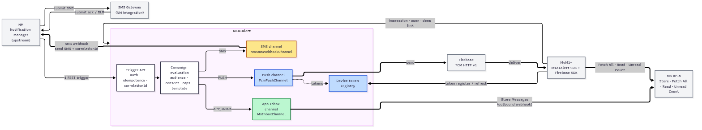
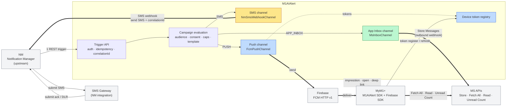
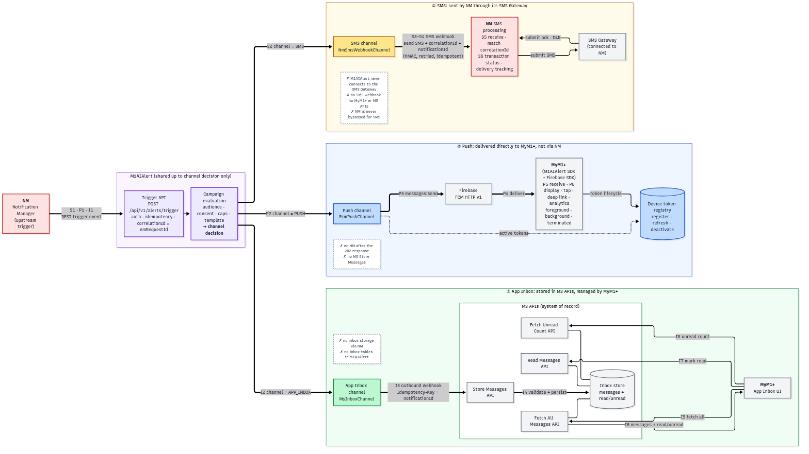
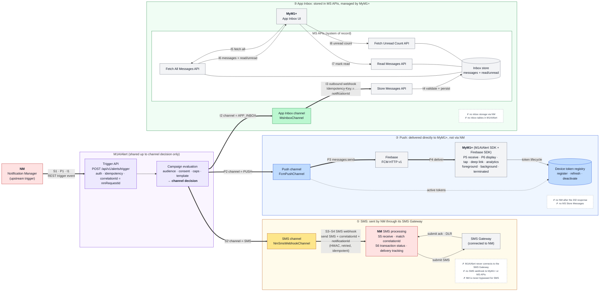
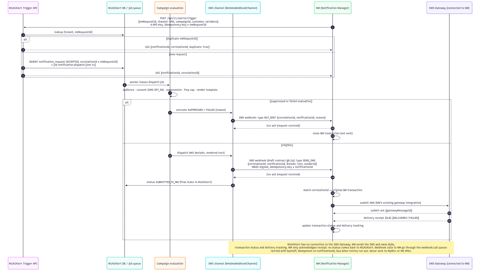
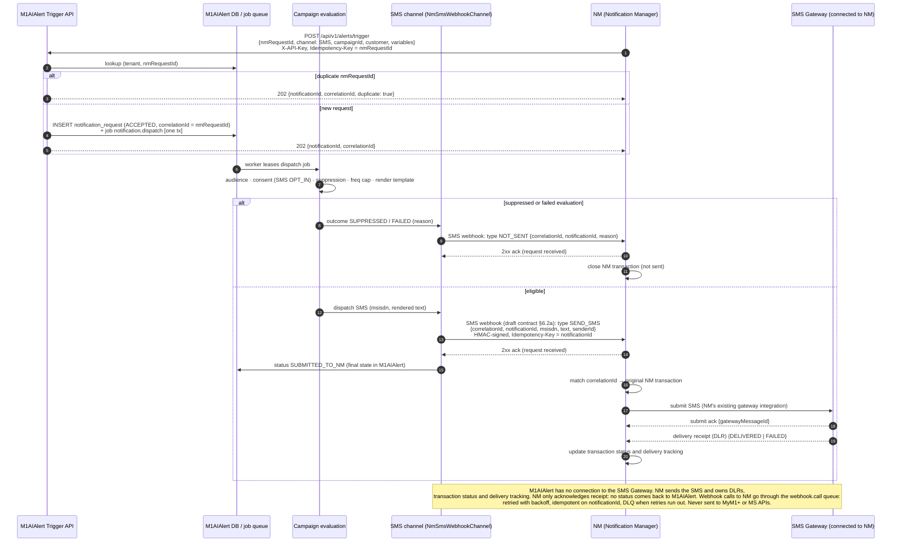
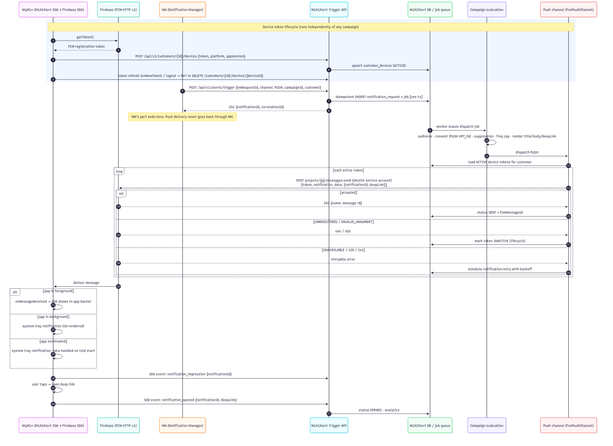
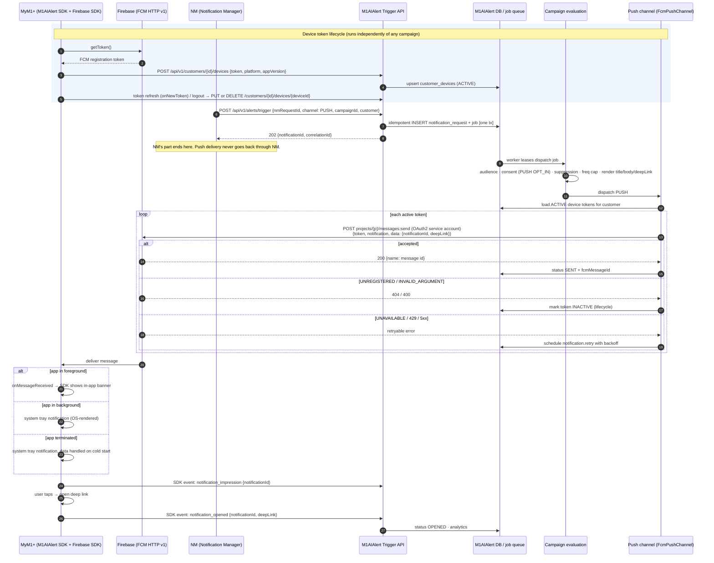
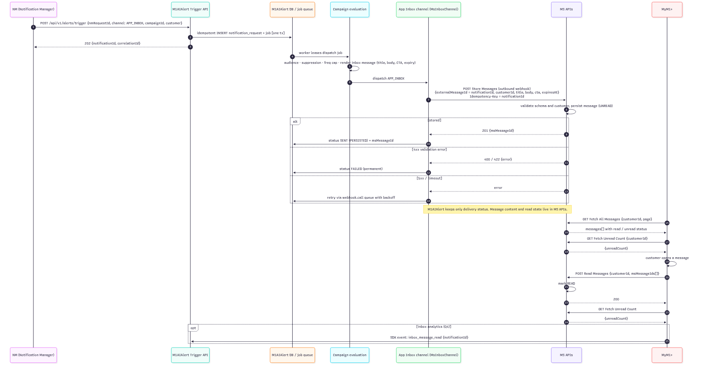
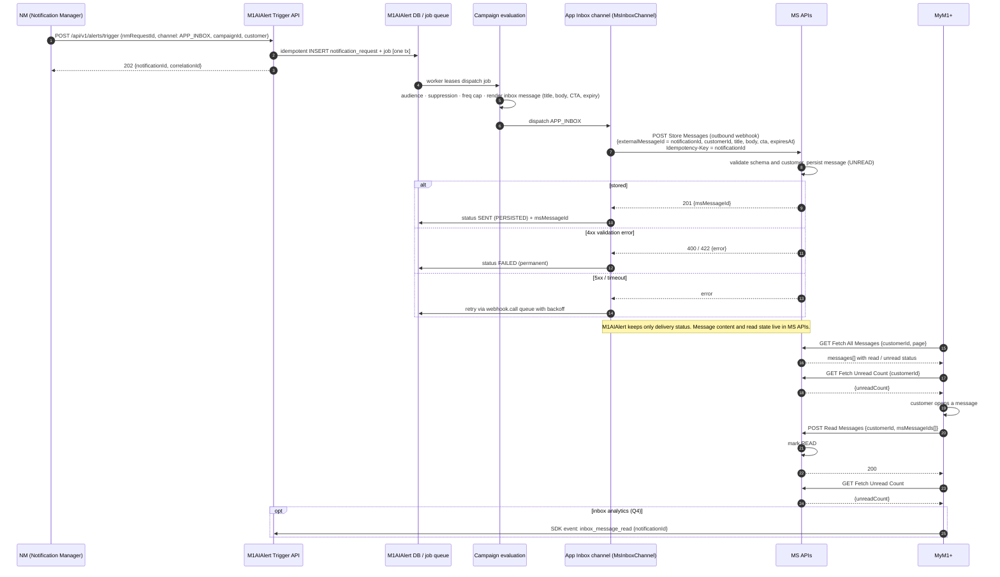

# Notification Channel Architecture: SMS, Push and App Inbox

Status: **Approved 2026-11-13** (decisions D13–D18 in §7). Open questions Q3–Q6 remain (§8).

This document defines three **separate** notification channels for M1AIAlert (this platform). Each channel has its own owner, delivery path and callback or persistence contract. They are not built on a shared generic notification webhook.

Rendered images: [`diagrams/channel-e2e.svg`](diagrams/channel-e2e.svg) (end-to-end), [`diagrams/channel-overview.svg`](diagrams/channel-overview.svg), [`diagrams/channel-sms.svg`](diagrams/channel-sms.svg), [`diagrams/channel-push.svg`](diagrams/channel-push.svg), [`diagrams/channel-inbox.svg`](diagrams/channel-inbox.svg).

## 1. Systems and names

| Name | What it is | Owns |
|---|---|---|
| **NM** | M1 Notification Manager, an upstream system outside this repo | Triggering notifications. For SMS: transaction status, correlation ID and delivery tracking |
| **M1AIAlert** | This platform (the CEP in `~/engagement-platform`) | Campaign evaluation (audience, consent, caps, template) and the dispatch to each channel |
| **SMS Gateway** | SMS gateway connected to NM through NM's existing integration. M1AIAlert has no connection to it | Sending SMS and returning delivery receipts (DLRs) to NM |
| **Firebase (FCM)** | Firebase Cloud Messaging, HTTP v1 API | Push transport to devices |
| **MyM1+** | M1's customer mobile app, with the M1AIAlert SDK and the Firebase SDK | Showing push notifications, deep links and the App Inbox UI |
| **MS APIs** | M1 microservices: Store Messages, Fetch All Messages, Read Messages, Fetch Unread Count | App Inbox storage and read/unread status |

> **Naming collision.** The existing design docs use "Notification Manager" for M1AIAlert's *internal* dispatch module. To keep it distinct from the external **NM**, this document calls that module the **Channel Dispatcher**. D13 is approved, so the module is now named Channel Dispatcher everywhere.

## 2. Channel summary (mandatory validation matrix)

| Channel | Initial trigger | Delivery / processing | Callback or persistence | Must NOT |
|---|---|---|---|---|
| SMS | NM → M1AIAlert (REST) | M1AIAlert → SMS webhook → NM → SMS Gateway | DLRs → NM. NM tracks status against the correlation ID | Connect M1AIAlert to the SMS Gateway. Send SMS webhooks to MyM1+ or MS APIs. Bypass NM |
| Push | NM → M1AIAlert (REST) | M1AIAlert → Firebase (FCM HTTP v1) → MyM1+ | Handled directly on the device. SDK engagement events go to M1AIAlert | Route through NM. Use MS Store Messages |
| App Inbox | NM → M1AIAlert (REST) | M1AIAlert → MS Store Messages API (outbound webhook) | Stored in MS APIs. MyM1+ reads and updates through MS APIs | Route storage through NM. Store inbox messages in M1AIAlert |

### What the repo already contains

| Item | Current state in repo | Effect |
|---|---|---|
| NM → M1AIAlert trigger contract | Not present. Only `POST /notifications/send` (generic) and `/journeys/execute` are specified | New inbound contract needed (§6.1) |
| SMS webhook to NM | Not present. `ProviderAdapter.parseCallback` assumes provider callbacks come back into M1AIAlert | New `NmSmsWebhookChannel`. NM has no existing contract, so M1AIAlert proposes one (§6.2a) |
| SMS Gateway | Previously drawn as an M1AIAlert adapter | **Resolved (Q2):** NM owns the gateway connection. M1AIAlert needs no SMS gateway adapter |
| Firebase push | Listed only as a "future adapter"; D7 allows mock adapters only | Real-provider adapter, so approval is required (D16) |
| App Inbox | `inbox_messages` table and `/customers/{id}/inbox…` API owned by M1AIAlert | **Conflicts with the spec.** These would be removed in favour of MS APIs (D15) |
| "Single path for all channels" (ARCHITECTURE.md §1, NOTIFICATION_MANAGER_DESIGN.md) | Shared pipeline and shared SPI | Shared up to campaign evaluation. After that, each channel has its own adapter, contract and status model (D14) |
| Notification code | None yet (Phase 8 pending) | Docs-only change. No code to migrate |

## 3. Overview



<details><summary>Mermaid source</summary>



</details>

The three channels share only the trigger API and campaign evaluation. Everything after the channel decision is separate.

## 3a. End-to-end architecture (numbered steps)

Step numbers match the required flows: **S1–S6** for SMS, **P1–P6** for Push and **I1–I8** for App Inbox. Each lane also lists what that channel must not do. The source is [`diagrams/channel-e2e.mmd`](diagrams/channel-e2e.mmd) and the rendered image is [`diagrams/channel-e2e.svg`](diagrams/channel-e2e.svg) (or [`.png`](diagrams/channel-e2e.png)).



<details><summary>Mermaid source</summary>



</details>

## 4. Sequence diagrams

### 4.1 SMS: NM → M1AIAlert → SMS webhook → NM → SMS Gateway



<details><summary>Mermaid source</summary>



</details>

### 4.2 Push: NM → M1AIAlert → Firebase → MyM1+



<details><summary>Mermaid source</summary>



</details>

### 4.3 App Inbox: NM → M1AIAlert → MS Store Messages → MyM1+



<details><summary>Mermaid source</summary>



</details>

## 5. Channel ownership rules

**SMS**
- Keep NM's existing SMS processing responsibilities. M1AIAlert adds campaign evaluation in front of SMS. It does not replace NM's transaction tracking.
- M1AIAlert sends the rendered SMS to NM through the SMS webhook. **NM connects to the SMS Gateway**: it submits the SMS, receives the DLRs and tracks delivery. M1AIAlert has no gateway connection or credentials.
- Every SMS webhook call carries `correlationId` (= NM's original `nmRequestId`) and `notificationId`, so NM can match it to its original request.
- M1AIAlert status order: `ACCEPTED → SUBMITTED_TO_NM` (final), or `SUPPRESSED` / `FAILED` before handoff. NM only acknowledges receipt, so M1AIAlert never learns DELIVERED / FAILED for SMS. SMS frequency caps and campaign analytics count at handoff, and SMS delivery rates are reported from NM, not M1AIAlert. Webhook calls are at-least-once, so NM must accept duplicates on `notificationId` without changing anything.
- No SMS status is ever sent to MyM1+ or MS APIs.

**Push**
- Sent straight to FCM using the HTTP v1 API and a service-account OAuth2 token. Credentials are encrypted at rest, as described in ARCHITECTURE.md §6.
- Token lifecycle: register on first launch, update on `onNewToken`, deactivate on logout, and deactivate automatically when FCM returns `UNREGISTERED`.
- Messages include `notification` and `data` payloads (with `notificationId` and `deepLink`), so the SDK can track impressions and opens in every app state.
- NM is not called after the 202 response. MS Store Messages is never used for push.

**App Inbox**
- MS APIs are the system of record for inbox content and read state. M1AIAlert does **not** keep `inbox_messages` and does **not** expose inbox read APIs.
- Store Messages calls are idempotent on `notificationId`, so a retry cannot create a duplicate inbox entry.
- MyM1+ talks only to MS APIs for listing messages, marking them read, and getting the unread count.

## 6. Contracts to define (each is separate, none is generic)

| # | Contract | Direction | Notes |
|---|---|---|---|
| 6.1 | Alert trigger | NM → M1AIAlert | `POST /api/v1/alerts/trigger`. API key. `nmRequestId` is both the idempotency key and the correlation ID. Returns 202 |
| 6.2 | SMS webhook (SEND_SMS / NOT_SENT) | M1AIAlert → NM | No existing NM contract. **Draft in §6.2a**, to be confirmed with NM. NM replies with an ack only |
| 6.3 | SMS Gateway submit / DLR | NM ↔ SMS Gateway | NM's existing integration. Outside M1AIAlert. Not changed |
| 6.4 | FCM HTTP v1 send | M1AIAlert → Firebase | Firebase project and service account (Q3) |
| 6.5 | Device registration + SDK events | MyM1+ → M1AIAlert | `/api/v1/customers/{id}/devices`, `/api/v1/sdk/events` |
| 6.6 | MS Store Messages | M1AIAlert → MS | Schema, auth (OAuth2 client credentials or mTLS), idempotency header (Q5) |
| 6.7 | MS Fetch All / Read / Unread Count | MyM1+ → MS | Owned by the MS team. Documented here only for reference |

Each of 6.2, 6.4 and 6.6 is its own `ChannelAdapter` implementation, with its own configuration, retry policy and status mapping. The journey `WEBHOOK` node and its allowlist are **not** used to deliver any channel.

### 6.2a Draft SMS webhook contract (M1AIAlert → NM)

Status: **draft, to be confirmed with NM's team.** There is no existing NM contract to reuse.

**Request**

```http
POST {NM_BASE_URL}/sms/requests          (path to be agreed with NM)
Content-Type: application/json
Idempotency-Key: {notificationId}
X-M1A-Timestamp: 2026-11-13T09:30:00Z
X-M1A-Signature: sha256=HEX(HMAC_SHA256(secret, timestamp + "." + rawBody))
```

```json
{
  "type": "SEND_SMS",
  "correlationId": "nm-req-123",
  "notificationId": "8f0c1c3e-5d1a-4b4e-9a1f-2f9c0e7b6a11",
  "campaignId": "cmp-roaming-alert",
  "msisdn": "+6591234567",
  "senderId": "M1",
  "text": "Hi Alex, your roaming pass is now active.",
  "encoding": "GSM7",
  "segments": 1,
  "sentAt": "2026-11-13T09:30:00Z"
}
```

| Field | Rule |
|---|---|
| `type` | `SEND_SMS` (please send this SMS) or `NOT_SENT` (M1AIAlert decided not to send, so close the transaction) |
| `correlationId` | NM's original `nmRequestId` from the trigger. Always present |
| `notificationId` | M1AIAlert's ID. Unique per SMS. Also the idempotency key |
| `msisdn`, `senderId`, `text`, `encoding`, `segments` | Present only for `SEND_SMS`. `msisdn` is E.164 |
| `reason` | Present only for `NOT_SENT`: `NO_CONSENT`, `SUPPRESSED`, `FREQUENCY_CAP`, `TEMPLATE_ERROR` or `INVALID_RECIPIENT` |

**Response:** an acknowledgement of receipt only. No delivery status is expected now or later.

| NM response | M1AIAlert action |
|---|---|
| `2xx` (body optional) | Mark `SUBMITTED_TO_NM`. Done |
| `409` duplicate `Idempotency-Key` | Treat as success (already received) |
| `400`, `401`, `403` or `422` | Permanent failure: mark `FAILED`, send to the DLQ and alert |
| `429`, `5xx` or timeout (10 s) | Retry with exponential backoff (1 m, 5 m, 15 m, 1 h, 6 h). After the last retry, send to the DLQ and mark `FAILED` |

**To confirm with NM:** the endpoint URL and path; HMAC shared secret or mTLS; whether NM needs extra fields such as an account or billing code; the default `senderId`; and whether NM wants `NOT_SENT` messages at all.

## 7. Decisions

| # | Decision | Status |
|---|---|---|
| D13 | M1AIAlert is triggered by the external NM over REST. The internal "Notification Manager" module is renamed to "Channel Dispatcher" | **Approved 2026-11-13** |
| D14 | Shared up to campaign evaluation, then three separate channel adapters (`NmSmsWebhookChannel`, `FcmPushChannel`, `MsInboxChannel`). No generic notification webhook. This replaces "single path" in ARCHITECTURE.md §1 | **Approved 2026-11-13** |
| D15 | App Inbox content and read state belong to MS APIs. Remove `inbox_messages` and the `/customers/{id}/inbox` APIs from M1AIAlert | **Approved 2026-11-13** |
| D16 | Real integrations: NM SMS webhook, FCM and MS Store Messages (no SMS gateway: NM owns it). Each has a mock implementation for local and test profiles. **Changes D7** | **Approved 2026-11-13** |
| D17 | M1AIAlert hands SMS to NM through the SMS webhook. NM sends the SMS through its SMS Gateway and owns DLRs and delivery tracking. NM only acknowledges receipt, so `SUBMITTED_TO_NM` is M1AIAlert's final SMS status | **Approved 2026-11-13** |
| D18 | No NM SMS contract exists to reuse. M1AIAlert publishes the draft contract in §6.2a for NM to implement or confirm. It sits behind `NmSmsWebhookChannel`, so field names can be remapped without touching campaign logic | **Approved 2026-11-13** |

## 8. Open questions (to answer before implementation)

1. ~~**NM SMS contract**~~ **Answered 2026-11-13:** there is no existing NM contract to reuse. M1AIAlert proposes the draft in §6.2a, which **NM's team must confirm**: endpoint URL, auth (HMAC secret or mTLS), sender ID and any NM-specific fields.
2. ~~**SMS sender**~~ **Resolved 2026-11-13:** M1AIAlert sends to NM, and NM connects to the SMS Gateway. NM receives DLRs directly.
3. **Firebase:** which Firebase project and service account? Is APNs set up through FCM for iOS?
4. **Analytics:** should MyM1+ report inbox read events to M1AIAlert as well, or only to MS?
5. **MS APIs:** what are the Store Messages schema, authentication method, rate limits and retention or expiry rules?
6. **NM visibility of Push and Inbox:** does NM need a final status for Push or App Inbox? If it does, add a status query API. Delivery itself would still not go through NM.
7. ~~**SMS final status back to M1AIAlert**~~ **Answered 2026-11-13:** NM only acknowledges receipt. No status comes back, and M1AIAlert stops at `SUBMITTED_TO_NM`.
